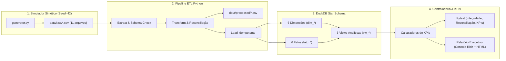

# Arquitetura de Dados e Software — INTERFOOD FINANCIAL INTELLIGENCE

> **AVISO IMPORTANTE:** Todos os dados deste projeto são **100% SINTÉTICOS e fictícios**, gerados deterministicamente (`seed=42`) exclusivamente para fins de demonstração técnica em Controladoria e Ciência de Dados. Nenhuma informação real da Interfood ou de terceiros foi utilizada.

---

## 1. Visão Geral da Arquitetura

O **INTERFOOD FINANCIAL INTELLIGENCE** foi projetado seguindo padrões modernos de **Analytics Engineering** e **Controladoria Corporativa**, estruturado em quatro camadas desacopladas:

1. **Geração de Dados Sintéticos (`src/interfood/data/`)**: Simulador estocástico reproduzível (`seed=42`) que modela 36 meses de operação (Jan/2022 a Dez/2024) de uma distribuidora B2B de alimentos e bebidas.
2. **Pipeline ETL e Qualidade de Dados (`src/interfood/etl/`)**: Extração validada, transformação contábil, reconciliação centavo a centavo entre cabeçalhos e itens, construção da dimensão calendário (`dim_tempo`) e carga transacional idempotente.
3. **Data Mart Analítico Star Schema (`src/interfood/database/`)**: Banco analítico colunar **DuckDB** (`data/interfood.duckdb`) com 6 dimensões, 6 tabelas fato e 6 views OLAP pré-configuradas para Controladoria (DRE, Budget vs Realizado, Mix de Margem, Curva de Clientes e Posição de Estoque).
4. **Camada de Inteligência Financeira & KPIs (`src/interfood/kpis/` e `scripts/04_relatorio_executivo.py`)**: Motor de cálculo de indicadores de rentabilidade, eficiência comercial, aderência orçamentária, semáforo de metas e exportação executiva.

---

## 2. Diagrama de Fluxo de Dados

---

## 3. Identidade Visual Executiva

Todos os relatórios, painéis de terminal (`Rich`) e exportações HTML seguem a identidade visual executiva definida para o case:

| Elemento Visual | Cor Hexadecimal | Aplicação |
| :--- | :--- | :--- |
| **Azul-Marinho Executivo** | `#0A1628` | Cabeçalhos institucionais, fundos de destaque e títulos de tabelas |
| **Branco Puro** | `#FFFFFF` | Tipografia sobre fundo escuro, cartões de indicadores e áreas de leitura |
| **Verde Esmeralda** | `#00A86B` | Bordas de destaque, indicadores positivos, atingimento de metas e selos de validação |
| **Padrão Numérico** | `pt-BR (R$)` | Moeda em Real (`R$ 1.234.567,89`), percentuais (`28,45%`) e inteiros (`18.450`) |

---

## 4. Decisões Arquiteturais (ADRs)

### ADR-01: DuckDB como Engine OLAP Embarcada
- **Contexto**: Consultas de Controladoria exigem agregações pesadas sobre dezenas de milhares de itens de pedido, cruzamentos temporais (`LAG`, `ROW_NUMBER`) e cálculo de DRE em tempo real.
- **Decisão**: Adoção do **DuckDB** (`duckdb>=0.10.0`) como banco colunar embarcado em arquivo único.
- **Benefícios**: Zero necessidade de servidor externo, execução vetorizada em milissegundos, suporte completo a SQL analítico (CTEs, Window Functions) e integração nativa zero-copy com Pandas.

### ADR-02: Modelagem Star Schema Estrita
- **Contexto**: Separar atributos descritivos (clientes, produtos, departamentos, calendário, plano de contas) das transações mensuráveis (pedidos, itens, devoluções, despesas, orçamento, estoque).
- **Decisão**: Implementação de 6 tabelas `dim_*` e 6 tabelas `fato_*` conectadas por chaves substitutas/naturais padronizadas e `data_id` no formato inteiro `YYYYMMDD`.

### ADR-03: Idempotência e Reconciliação no ETL
- **Contexto**: Em pipelines financeiros, reexecuções não podem duplicar lançamentos nem permitir divergências entre analítico (itens) e sintético (cabeçalho do pedido ou DRE).
- **Decisão**: O módulo `load.py` limpa e recarrega as tabelas na ordem correta de dependência em cada execução, enquanto `transform.py` valida que $\sum \text{Itens} = \text{Pedido}$ antes da carga.
